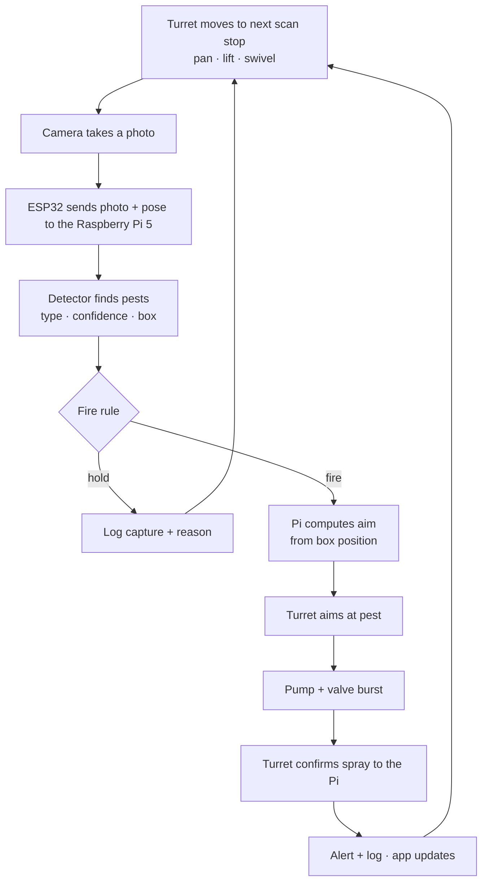
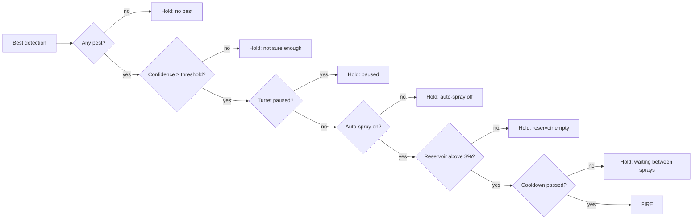
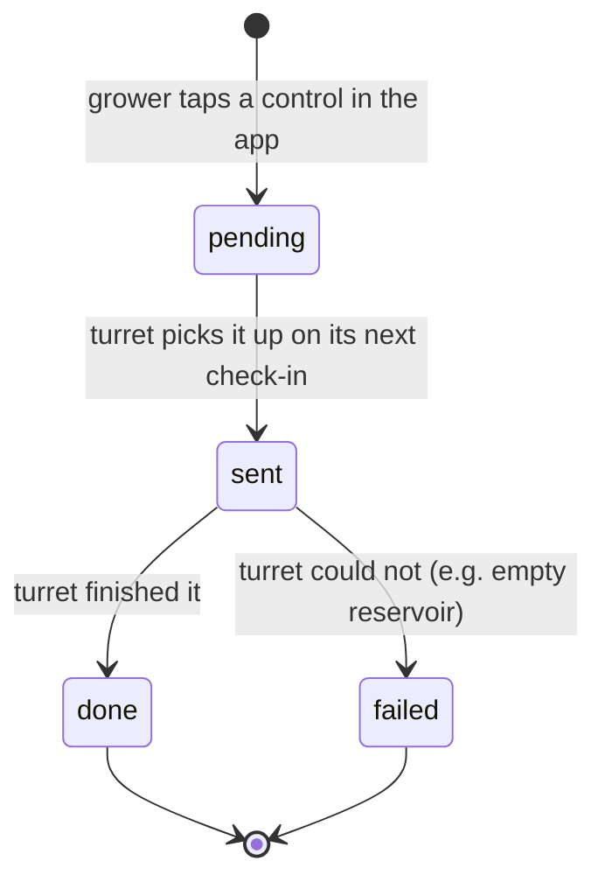
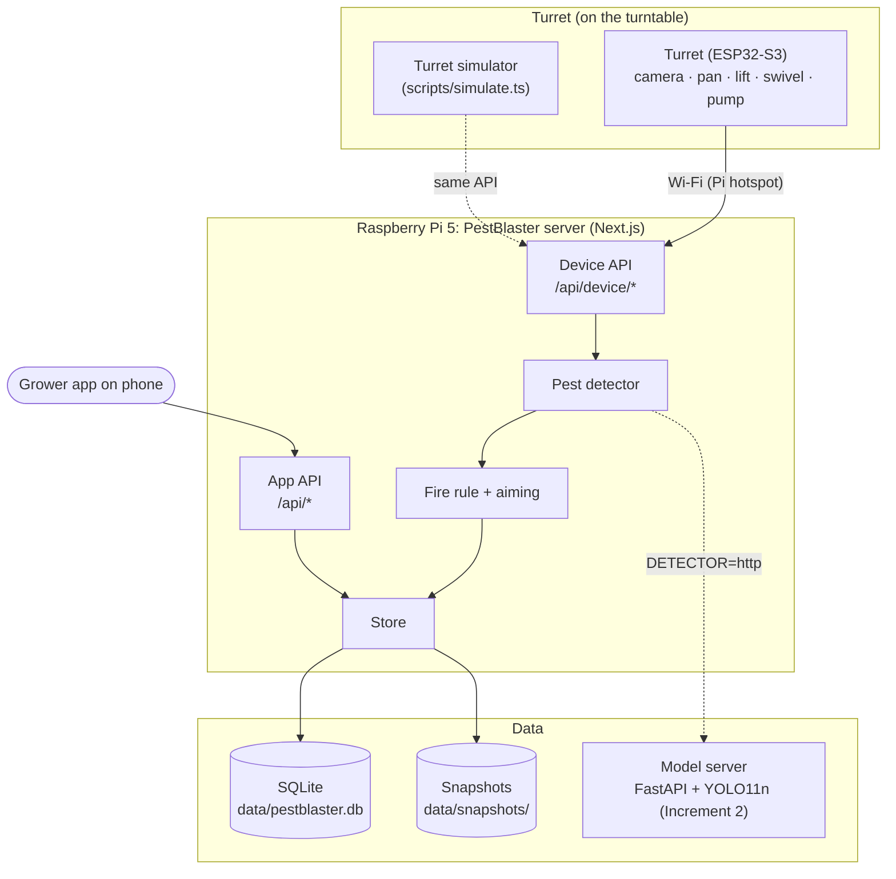
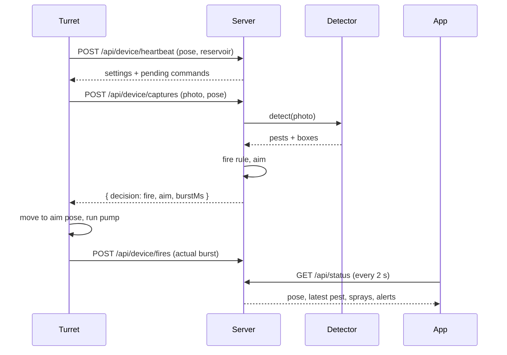
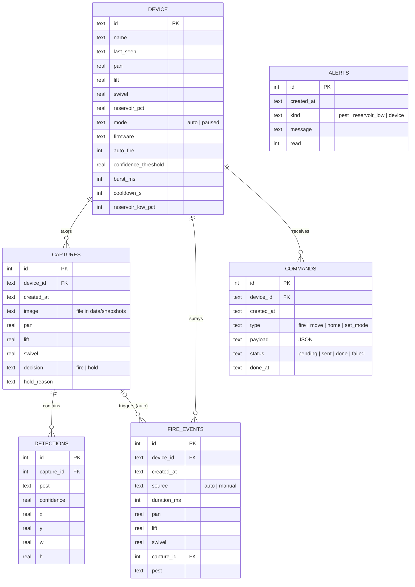

# PestBlaster — Project Documentation

> **Status:** v0.2 (16 Oct 2026). Increment 1 (software) implemented and tested on the `development` branch. Hardware build started for the 25% check (Oct 30).
> **Sources:** the design is taken from the *(for approval)* Main, Hardware & Software Specifications and Function/Features List documents (October 2026) and blueprint v15 (52 sheets, 11 Oct 2026). Where those two disagree, both are given and the item is listed in [section 16.4](#164-open-items-approval-documents-vs-blueprint-v15).
> Anything marked *(planned)* is not built yet. Sections 5, 8–10 and 12–15 describe the Increment 1 code as it is today; [section 16.5](#165-code-vs-the-approved-design) lists where that code still differs from the approved design.
> Diagrams are written in [Mermaid](https://mermaid.js.org/) and render directly on GitHub.

## Table of Contents
1. [Feature Information](#1-feature-information)
2. [Project Information](#2-project-information)
3. [Overview](#3-overview)
4. [System Flow](#4-system-flow)
5. [User Interface & Features Breakdown](#5-user-interface--features-breakdown)
6. [Core Concepts](#6-core-concepts)
7. [System Architecture](#7-system-architecture)
8. [Design System](#8-design-system)
9. [Data Model](#9-data-model)
10. [API Endpoints](#10-api-endpoints)
11. [Hardware Summary](#11-hardware-summary)
12. [Frontend Architecture](#12-frontend-architecture)
13. [Backend Implementation](#13-backend-implementation)
14. [Setup & Configuration](#14-setup--configuration)
15. [Common Tasks](#15-common-tasks)
16. [Known Issues, Caveats & Open Questions](#16-known-issues-caveats--open-questions)
17. [Quick Reference for the Next Developer](#17-quick-reference-for-the-next-developer)
18. [Appendix A — Increment Plan](#appendix-a--increment-plan)
19. [Appendix B — Testing Strategies](#appendix-b--testing-strategies)
20. [Appendix C — Pest Detection Model Plan](#appendix-c--pest-detection-model-plan)
21. [Appendix D — Documentation Checklist](#appendix-d--documentation-checklist)

---

## 1. Feature Information

| Field | Value |
|-------|-------|
| **Project** | PestBlaster: Design and Development of an Autonomous Rotating Turret System for Detection and Organic Deterrence of Leaf-Feeding Pests in Lettuce Crops |
| **Type** | Embedded turret (ESP32-S3 CAM) + on-board AI computer (Raspberry Pi 5) + mobile-first app |
| **Status** | Increment 1 (software) built and tested; hardware build started; model not trained yet |
| **Degree / Course** | BS Computer Engineering, Project Design (CpE 481) |
| **School** | Cebu Institute of Technology – University |
| **Adviser** | Engr. Nikko D. Alferez |
| **Primary users** | Small-scale lettuce farm owners. The prototype is tested on two raised planter boxes. |
| **Target pests** | Loopers, armyworms/cutworms, aphid clusters |
| **Frontend + API** | Next.js 15 (App Router), React 19, TypeScript |
| **Database** | SQLite (built into Node.js 22) — file in `data/` |
| **Pest detection** | YOLO11n with OpenCV preprocessing on the Raspberry Pi 5, served by FastAPI + Ultralytics *(planned, Increment 2)*; a simulated detector stands in today |
| **Turret controller** | ESP32-S3 CAM (N16R8) with OV5640 camera *(planned)*; a software simulator plays its part today |
| **ESP32 ↔ Pi link** | Wi-Fi through the Pi 5's own hotspot (blueprint v15, sheet 34); no internet or router needed. Decided 16 Oct 2026; the approval documents still say USB until they are edited (section 16.4) |
| **Architecture style** | Modular monolith on the Pi (Next.js app + API, SQLite, model server) + thin device client (ESP32) |
| **Key flow** | Turret scans → sends photo to the Pi → Pi detects pest → Pi decides fire or hold and where to aim → turret aims and sprays → app shows it all |

---

## 2. Project Information

### Repository
| Field | Value |
|-------|-------|
| **Repository** | [github.com/helidastar/PestBlaster](https://github.com/helidastar/PestBlaster) |
| **Default branch** | `main` |
| **Documentation** | `docs/DOCUMENTATION.md` (this file) |

### Branches
| Branch | Purpose | Status |
|--------|---------|--------|
| `main` | Finished, stable software. Only updated when development is done and the project is in maintenance. | Exists |
| `development` | Working branch. Every feature is merged here and every increment is checked from here. | Exists |
| `feat/increment-1` | Increment 1 software and this documentation (merged into `development`) | Merged |
| `feat/firmware` *(suggested)* | ESP32-S3 firmware in `firmware/` | Suggested |
| `feat/model` | Dataset scripts, training notebooks and the model server (pull request #3) | Open |

| Tag | Points to |
|-----|-----------|
| `increment-1` | `development` as checked at Increment 1 *(create after the check)* |

**Branch naming:** `feat/<area>` for features, `fix/<area>` for fixes.

**Commit messages:** one line, `type(area): what changed`, for example `feat(ui): add spray history tab`. Types: `feat`, `fix`, `docs`, `test`, `chore`, `refactor`.

**Branch flow:** `feat/<area>` → `development` (pull request, squash and merge) → `main` (only when development is done).

**After each increment check:** tag what was checked so it can always be restored.

```bash
git fetch origin
git tag -a increment-N origin/development -m "increment N checked"
git push origin increment-N
```

To look at a checked version: `git checkout increment-1`. To restore it: `git checkout -b fix/restore increment-1`, then open a pull request into `development`.

### Contributors
| Name | GitHub |
|------|--------|
| Adriyanna G. Diana | [@adiii568](https://github.com/adiii568) |
| Maria Mhikyla L. Jayno | [@mhiksNmatch](https://github.com/mhiksNmatch) |
| Charity T. Ricabo | [@helidastar](https://github.com/helidastar) |

**Adviser:** Engr. Nikko D. Alferez

### Milestones (to date)
| Date | Milestone |
|------|-----------|
| 2026-09-19 | Title defense. Panel asked for: lettuce/leafy crops instead of round cabbage, full 360° turret rotation, automatic up–down movement. |
| 2026-09-24 | Approval sheet submitted |
| 2026-09-26 | Increment 1 software (backend, app, simulator) pushed |
| 2026-10 | Design moved to an on-board Raspberry Pi 5; target pests and users revised; (for approval) documents and revised approval sheet prepared |
| 2026-10-11 | Blueprint v15 (52 sheets) and electronics schematic v15 |
| 2026-10-30 | 25% check: base rotation and lift *(scheduled)* |
| 2026-11-03 to 11-13 | 50% build: spray line, arm and head, trained model, prototype app *(scheduled)* |
| 2026-11-23 to 11-27 | Panel defense *(scheduled)* |

---

## 3. Overview

### 3.1 Problem statement
Lettuce is grown on small-scale farms, but it is vulnerable to leaf-feeding pests. Caterpillars such as loopers, armyworms and cutworms eat the leaf tissue, and aphids suck plant sap, discolor and distort the leaves, and transmit viral diseases. Left unchecked, these pests cause holes and skeletonized leaves, stunted growth and yield loss. Existing smart garden systems only **monitor and alert**; they take no physical action. On farms without constant supervision, pests can cause serious leaf damage in the time between an alert and someone responding. There is no low-cost, autonomous system that detects these pests on lettuce and **immediately responds with a physical deterrent**, without waiting for a person to act.

### 3.2 Goals
**General objective:** design and develop PestBlaster, an autonomous pest detection and deterrence turret that protects lettuce crops by detecting leaf-feeding pests and immediately dispersing an organic deterrent.

**Specific objectives** (from the (for approval) Main document)
1. To design a machine vision pipeline, running on an on-board Raspberry Pi 5, that detects and classifies common lettuce leaf pests (loopers, armyworms/cutworms, and aphid clusters) using a YOLO11n model with OpenCV image processing.
2. To develop a rotating turret mechanism with 360° rotation and a vertical scanning axis, controlled by an ESP32-S3 microcontroller, that can aim at a detected pest anywhere on the lettuce plant, from the top leaves down to soil level.
3. To implement a valve/pump control system that releases timed organic deterrent bursts only after the Raspberry Pi confirms a pest target.
4. To build a companion mobile app that lets farm owners monitor pest activity, view detection logs, and manage the system remotely.
5. To evaluate detection accuracy, response time, and reduction in leaf damage compared to a passive monitoring-only baseline.

### 3.3 Success looks like
- A pest is sprayed **within seconds** of being photographed, with no one present.
- A farm owner opens the app and can tell at a glance: is the turret online, where is it looking, what did it find, did it spray, is the bottle running low.
- The farm owner can **stop or take over** the turret at any time (harvesting, refilling, maintenance).

### 3.4 Stakeholders
| Stakeholder | Interest / role | What they need from the system |
|-------------|-----------------|--------------------------------|
| Small-scale lettuce farm owners and workers | Protect the crop with less supervision | Low cost, less chemical exposure, no special pest knowledge needed |
| Development team | Build and test the system | Clear increments, testable software before hardware exists |
| Adviser and panel | Evaluate the project | Working increments, measured accuracy and response time |

### 3.5 Project functions → where they live
| # | Function (from proposal) | Increment 1 status | Where |
|---|--------------------------|--------------------|-------|
| 1 | Pest detection | Pipeline built; simulated detector, HTTP model hook ready | `src/lib/detector/` |
| 2 | Target tracking (pan, lift, swivel) | Aim math and scan path built and tested; simulated turret | `src/lib/targeting.ts`, `src/lib/scan.ts` |
| 3 | Automated deterrent firing | Fire/hold rule built and tested; simulated spray | `src/lib/decision.ts` |
| 4 | Remote monitoring | Built | App: Turret and Pests screens |
| 5 | Alert notifications | In-app alerts built (pest found, refill needed); phone push *(planned)* | `src/lib/store.ts`, History → Alerts |
| 6 | Manual override | Built (spray now, move, return home, pause, auto-spray off) | App: Control screen |
| 7 | Data logging | Built (every capture, detection, spray, command) | SQLite, History → Trends |

### 3.6 Scope & limitations
**Scope** (from the (for approval) Main document):
- Designed for small-scale lettuce farm owners. The prototype is tested on two raised planter boxes.
- The turret stands on the ground between two raised planter boxes, each about 40 cm high (soil surface) and 30 cm wide, with one row of lettuce per box (design estimates).
- Target pests: loopers, armyworms/cutworms, and aphids.
- Organic, non-toxic botanical spray, safe for edible crops when used as directed.
- A fixed detection and spray radius set by the 0.5 m arm.
- The app covers monitoring, alerts and manual override (no marketplace or yield prediction).

**Limitations:**
- The deterrent only repels pests; it does not kill them and is not a substitute for full integrated pest management.
- Accuracy may drop for small, green-bodied pests such as loopers, when leaves overlap and hide the pest, and in poor light, rain or wind.
- The whole assembly rotates on a turntable; play in the lazy susan bearing appears as wobble at the arm tip.
- The belt and bearing sit in a gap under the turntable; a splash skirt covers it, but soil and water can still reach it over time.
- The hanging swivel mount turns ±90°; its hose and cable flex with every sweep and need strain relief and cycle testing.
- The 0.5 m arm, balanced by a counter-arm and stiffened with a steel rod, may still sway in wind, which affects fine targeting.
- The lift has a fixed 30 cm travel and moves slowly; taller plants or other bed heights may not be fully covered.
- The head reaches only about 20 cm past the planter box wall, so the system suits narrow boxes only.
- A fine mist drifts in wind, and botanical sprays may clog the nozzle; a strainer and a plain-water flush are needed.
- Detection runs on the on-board Raspberry Pi 5, so it works without internet. The ESP32-S3 never sprays on its own; if the Pi or the link fails, it stops all motion and waits.
- One camera head; a second head on the counter-arm is future work.
- Night detection uses the IR illuminator; night accuracy may be lower than in daylight.
- Not rated for extreme weather. The reservoir needs periodic manual refilling.

**Project limits for the thesis claims** (project brief and blueprint v15): pests on exposed leaf surfaces and fresh damage only; early-instar larvae only out to 0.90 m; aim valid in wind up to 0.5 m/s; one battery charge covers one evening schedule. One of these differs from the approval documents (leaf undersides); see section 16.4.

---

## 4. System Flow

### 4.1 Scan–detect–aim–spray loop



### 4.2 Fire rule (checked in this order)



### 4.3 Manual command lifecycle



The app shows these as **Waiting for turret → Turret is doing it → Done / Turret could not do it**.

In the approved design, the turret first **homes** (turns until the home switch meets the home tab, setting 0°) and corrects its position each time it passes home. The lift is raised before the base rotates so the head clears the planter box walls.

---

## 5. User Interface & Features Breakdown

A mobile-first web app. It can be added to the phone's home screen (web app manifest). Four tabs along the bottom.

| Screen | Contents |
|--------|----------|
| **Turret** (home) | Online/offline status · auto-spray on/off · **turret map** (top-down view: arm shows pan angle, rings show height from soil to top, shapes show recent pest sightings, a ripple marks the latest spray) · lift gauge · pan/lift/swivel readout · auto-spray switch · reservoir bottle level · today's counts (spots checked, pests seen, sprays) · latest pest photo with what the turret did |
| **Pests** | Every photo with a pest, newest first, with detector boxes and confidence · filter by pest · shows whether it was sprayed or why not · pose and leaf top / under leaf |
| **Control** | Pause / resume turret · **Spray now** · aim by hand (pan, lift, swivel sliders → Move turret, Return home) · spray settings (confidence threshold, spray length, wait between sprays, low-bottle warning) · recent commands with progress |
| **History** | Trends: stacked bars of pests per day for 7 days, with hover details and a table view · Sprays: every spray (auto or manual) with pest and pose · Alerts: pest found, refill needed (unread badge on the tab) |

Design priorities: readable outdoors on a phone, large touch targets, plain language ("Spray now", not "Trigger actuator"), and every hold reason spelled out so the grower knows why it did not spray.

---

## 6. Core Concepts

### 6.1 Pest types
The approved design targets **loopers, armyworms/cutworms and aphid clusters**. The Increment 1 code still uses the older list below; changing it is a code task (section 16.5).

| Code (Increment 1) | Name | Scientific name | Notes for the model |
|------|------|-----------------|---------------------|
| `diamondback_larva` | Diamondback moth larva | *Plutella xylostella* | **Dropped from the target list.** Replace with an armyworm/cutworm class (*Spodoptera* spp. / *Agrotis* spp.) |
| `looper` | Looper | *Trichoplusia ni* | Green, arches its body; blends into the leaf (hardest class) |
| `aphid_cluster` | Aphid cluster | Aphididae | Groups of tiny insects; single aphids are too small to see from the turret (blueprint v15), so the model targets clusters |

### 6.2 Turret pose (the coordinate system)
| Axis | Range | Meaning |
|------|-------|---------|
| **Pan** | 0–360° | Base rotation, 0° = reference direction, clockwise |
| **Lift** | 0–300 mm | Telescoping post travel. 0 = lowest (soil level), 300 = highest |
| **Swivel** | −170° to +170° | Camera + nozzle angle. 0° = level, 90° = straight down, above 90° = swung back to look under the leaf. **Approved design: swivel ±90° plus a separate tilt servo** (section 16.5) |

The nozzle is mounted beside the camera, so aiming the camera at a pest also aims the spray.

### 6.3 Scan path
One sweep = 12 pan stops (every 30°) × 3 heights (300, 150, 0 mm) × 2 camera angles (60° leaf top, 130° under leaf) = **72 photos**. The lift direction alternates between pan stops (top→soil, then soil→top) so the post never makes an empty return trip. Defined in `src/lib/scan.ts`.

Approved design: scan at set stops over the two planter boxes only, at three heights (top, middle, soil level). Blueprint v15 instead patrols 12 stops 30° apart with the lift down and 4 frames per stop (swivel ±30° × tilt 35°/75°). See section 16.4.

### 6.4 Aiming
The detector returns a box in image coordinates (0–1). The server converts the box center into angle corrections using the camera's field of view (OV5640 ≈ 68° × 52°, pinhole model). Blueprint v15 uses 60.3° × 47.1° (datasheet estimate, sheet 18); measure the real lens before the aim calibration:

- Box right of center → **pan** right; box below center → **swivel** down.
- If the swivel would pass ±170°, the remaining angle is covered by moving the **lift** instead (using the ~150 mm working distance).
- Lift is always clamped to 0–300 mm.

### 6.5 Default settings (changeable in the app)
| Setting | Default | Range | Why |
|---------|---------|-------|-----|
| Confidence threshold | 60% | 10–99% | Below this the turret logs but does not spray |
| Spray length | 400 ms | 100–3000 ms | R385 pump ≈ 2 L/min → ≈ 13 mL per burst |
| Wait between sprays | 10 s | 0–600 s | Lets the deterrent work; saves liquid |
| Low-bottle warning | 20% | 5–80% | Alert once when the level crosses it |
| Reservoir empty | 3% (fixed) | — | Pump must not run dry |

### 6.6 Alerts
| Alert | When | Repeat protection |
|-------|------|-------------------|
| Pest found | A confident pest is seen (sprayed, or held because paused / auto-spray off / cooldown / empty) | At most one per pest type every 5 minutes |
| Refill needed | Reservoir drops below the warning level | Once per crossing (not again until refilled above it) |

### 6.7 Online / offline
The turret checks in every few seconds. If the server has not heard from it for **30 seconds**, the app shows it as offline. Commands sent while offline wait until it reconnects.

### 6.8 Patrol schedule
The turret does not watch the plants all the time. It runs short patrols on a schedule set in the app, and stays parked between them to save battery (Function list: Patrol Schedule; blueprint v15, sheet 43).

| Window | Time | Every | Notes |
|--------|------|-------|-------|
| Day | 07:00–16:00 | 60 min | |
| Dusk | 17:30–19:30 | 15 min | While there is still enough light for the camera |
| Night | 19:30–23:30 | 30 min | Uses the IR illuminator (850 nm LED ring) |
| Manual | any time | — | "Start patrol" in the app |

One patrol (all active stops, 4 photos per stop) takes about 1 minute (≈ 57 s full ring, ≈ 32 s two beds; blueprint estimate, measured on test sheet 19). The live camera view is separate: it is for a person to watch, is not used for detection, and pauses the patrol while open.

The battery claim "one charge covers one evening schedule" covers dusk + night (≈ 2.85 Ah of a 7 Ah SLA, blueprint sheet 43). Day patrols add to that, so the full day + dusk + night use should be measured on the battery test.

### 6.9 If the Wi-Fi link drops
The ESP32 and the Pi talk over the Pi's own hotspot, about 1 m apart on the same turntable. There is no second (wired) link: a dropout fails safe instead.

| Step | What happens | Source |
|------|--------------|--------|
| 1 | No reply from the Pi within 5 s → no spray: pump off, valve stays closed | Blueprint v15, sheet 34 |
| 2 | The turret stops moving and keeps retrying the hotspot every few seconds | Proposed firmware rule |
| 3 | After about 1 minute without the Pi, it returns home and waits | Proposed firmware rule |
| 4 | When the link is back, it continues the patrol from the next stop | Proposed firmware rule |
| 5 | The app shows the turret as offline after 30 s without a check-in | Increment 1 code (section 6.7) |

Worst case is a missed spray, never a wrong one. Why not a USB backup: a wired link would have to run through the lift and the swivel, the joints with the highest cable-fatigue risk (section 3.6), to back up a failure that is already safe. The ESP32's USB port is kept for flashing and debugging. A USB backup link stays on the stretch list.

---

## 7. System Architecture

### 7.1 Architecture style
A **modular monolith** on the Raspberry Pi 5 (one Next.js app for API + mobile app, the SQLite database, and a FastAPI + YOLO11n model server) and a **thin device client** (the ESP32-S3 CAM). The ESP32 only moves, photographs, sprays and reports; all detection and decisions happen on the Pi. The ESP32-S3 does not have the memory for an accurate pest model, and an on-board Pi 5 removes the need for a laptop or an internet connection in the field.

### 7.2 High-level architecture



### 7.3 Capture sequence



### 7.4 Deployment
| Setup | When | Notes |
|-------|------|-------|
| Laptop | Software development and simulator demos | `npm run build && npm start`. Phone connects to `http://<laptop-ip>:3000` on the same Wi-Fi |
| Raspberry Pi 5 (4 GB) in the enclosure on the turntable | Prototype and field testing | Same app + SQLite + model server; no laptop or internet needed. The laptop is only for training the model and flashing the ESP32 |

Serverless hosts (e.g. Vercel) are **not** suitable while the database is a local SQLite file, because their disk is not persistent.

### 7.5 Key design decisions
| Decision | Why |
|----------|-----|
| Detection on the on-board Raspberry Pi 5, not the ESP32 | Accurate models need more memory than the ESP32-S3 has; models can be retrained and swapped without reflashing; works without internet. Rejected: a laptop or cloud server (needs a network link in the field) |
| Pi decides fire/aim, ESP32 obeys | One place for the rule; settings change instantly from the app; firmware stays small |
| Turret confirms each spray | Spray log reflects what really happened, not what was requested |
| Commands delivered on heartbeat | ESP32 only makes outgoing requests; if the Pi stops answering, the turret stops and waits |
| SQLite built into Node 22 | Zero setup, no accounts, one file to back up; enough for one turret |
| Simulator uses the real device API | Everything tested with the simulator is what the firmware will use |

---

## 8. Design System

### 8.1 Colors
| Token | Light | Dark | Use |
|-------|-------|------|-----|
| `--bg` | `#eef2e2` | `#16130f` | Page (butterhead leaf / night soil) |
| `--surface` | `#f8faf1` | `#211c16` | Cards |
| `--ink` | `#1f1a14` | `#e8eeda` | Text (soil) |
| `--leaf` | `#3d6b2a` | `#8fc46a` | Primary actions, "on" states |
| `--spray` | `#1a7488` | `#4fb3c6` | Anything to do with spraying / deterrent |
| `--danger` | `#b42318` | `#f07a6a` | Offline, refill needed |
| `--pest-dbm` | `#b07a12` | `#b8862a` | Diamondback moth larva |
| `--pest-looper` | `#7b4fb8` | `#9474dc` | Looper |
| `--pest-aphid` | `#c8406e` | `#db5f87` | Aphid cluster |

The three pest colors were checked with a colorblind-safety validator in both light and dark mode. Each pest also has its own **shape** (larva ●, looper ■, aphids ▲), so identity never depends on color alone.

### 8.2 Typography & layout
- **Familjen Grotesk** for headings, **Atkinson Hyperlegible** for body text (designed for legibility, useful outdoors in sunlight), **JetBrains Mono** for angles and readings.
- Single column, max 720 px, 16 px side gutter; bottom tab bar for one-thumb use.
- Respects dark mode and reduced-motion settings; visible keyboard focus.

### 8.3 Reusable components
`Radar` (turret map), `Reservoir` (bottle level), `Snapshot` (photo + detection boxes), `PestShape` / `PestLabel`, `TrendChart`, `Nav`.

---

## 9. Data Model

### 9.1 Entity relationship diagram



### 9.2 Tables
| Table | Purpose |
|-------|---------|
| `device` | One row per turret: last known pose, reservoir level, mode and spray settings. `turret-1` is created automatically. |
| `captures` | Every photo the turret sent, its pose, and the fire/hold decision with the reason. |
| `detections` | Pests found in a capture (type, confidence, box). |
| `fire_events` | Every spray the turret confirmed, auto or manual. |
| `commands` | Manual override queue from the app to the turret. |
| `alerts` | Messages shown to the grower. |

Timestamps are stored in UTC (ISO 8601). Daily trends are grouped by Philippine local day (UTC+8). Photos are saved only when at least one pest was detected, so the disk does not fill with empty leaves.

---

## 10. API Endpoints

### 10.1 Device API (used by the ESP32 firmware and the simulator)
Every request must send the header `x-device-key: <DEVICE_API_KEY>`. Optional `x-device-id` (default `turret-1`).

| Method | Path | Body | Returns |
|--------|------|------|---------|
| POST | `/api/device/heartbeat` | `{ pose: {pan, lift, swivel}, reservoirPct, firmware? }` | `{ mode, settings, commands[] }` — commands are now marked `sent` |
| POST | `/api/device/captures` | multipart: `image` (JPEG/PNG), `pose` (JSON string) | `{ captureId, detections[], decision }` |
| POST | `/api/device/fires` | `{ source: "auto"\|"manual", durationMs, pose, captureId? }` | the stored spray (201) |
| POST | `/api/device/commands/{id}` | `{ ok: true\|false }` | the updated command |

`decision` is either `{ "action": "fire", "target": {...}, "aim": {pan, lift, swivel}, "burstMs": 400 }` or `{ "action": "hold", "reason": "cooldown", "target": {...} }`.

Firmware loop *(planned)*: heartbeat → run any commands → move to next scan stop → capture → if `fire`, move to `aim`, run pump for `burstMs`, POST the spray, return to the scan stop → repeat.

### 10.2 App API
| Method | Path | Purpose |
|--------|------|---------|
| GET | `/api/status` | Everything for the home screen: device, online, today's counts, latest pest, last spray, recent commands, unread alerts |
| GET | `/api/captures?pest=&limit=` | Captures that contain pests, newest first |
| GET | `/api/fires?limit=` | Spray history |
| GET | `/api/stats?days=7` | Pests per type and sprays per day |
| GET / POST | `/api/alerts` | List alerts / mark all as read |
| PATCH | `/api/settings` | Change `autoFire`, `mode`, `confidenceThreshold`, `burstMs`, `cooldownS`, `reservoirLowPct` |
| GET / POST | `/api/commands` | List / queue `{type: "fire", durationMs}`, `{type: "move", pose}`, `{type: "home"}` |
| GET | `/api/snapshots/{file}` | A stored photo |

### 10.3 Example capture response
Turret at pan 90°, lift 150 mm, swivel 60° sees a larva right of and slightly above the image center:

```json
{
  "captureId": 128,
  "detections": [
    { "pest": "diamondback_larva", "confidence": 0.86,
      "bbox": { "x": 0.61, "y": 0.42, "w": 0.09, "h": 0.05 } }
  ],
  "decision": {
    "action": "fire",
    "target": { "pest": "diamondback_larva", "confidence": 0.86, "bbox": { "x": 0.61, "y": 0.42, "w": 0.09, "h": 0.05 } },
    "aim": { "pan": 101.8, "lift": 150, "swivel": 56.9 },
    "burstMs": 400
  }
}
```

---

## 11. Hardware Summary

*From the (for approval) Hardware & Software Specifications. Part codes, sizes and quantities are on blueprint v15; differences are listed in section 16.4.*

| Subsystem | Parts |
|-----------|-------|
| Power | 12 V 7 Ah SLA battery on the turntable (battery only, no solar panel) · 5 A fuse · SPST main switch · latching emergency stop (cuts all motors, servos and the pump) · INA219 voltage/current sensor · LM2596 12→5 V · XL4015 12→6 V (servos) · AMS1117 3.3 V · 12→5 V 3 A buck for a pocket Wi-Fi router (remote field testing only) |
| Base / rotation | Pallet-wood base staked to the ground · lazy susan bearing (≈ 300 mm) · plywood turntable disc · NEMA 17 + A4988 on the turntable · GT2 belt, motor pulley and fixed centre pulley · KW12 home switch + home tab · splash skirt |
| Vertical lift | 12 V linear actuator, 300 mm stroke, built-in end limit switches + DRV8871 · telescoping PVC post (1¼″ sleeve, 1″ inner pipe, 30 cm travel) · actuator clamps and rod bracket |
| Crossbar and head | PVC T-crossbar: 0.5 m arm + 0.25 m counter-arm, internal steel rod · counterweight end cap · ESP32-S3 CAM (ESP32-S3-WROOM-1 N16R8) · PCA9685 servo driver · PCF8574 I/O expander · OV5640 5 MP (IR-cut removed) · 850 nm IR LED ring (night patrols) · hanging swivel mount ±90° · 2 × MG996R (swivel, tilt) · sealed head housing with clear window |
| Deterrent | Recycled 2–3 L bottle upside down on a stand, UV-shielded · vented refill lid · inline strainer · R385 12 V diaphragm pump + 2-channel relay · coiled 6 mm PU hose · 12 V NC solenoid valve under the arm tip · silicone service loop 150–200 mm · brass misting nozzle |
| Enclosure | IP65 enclosure with cable glands and silica gel on the turntable · Raspberry Pi 5 (4 GB) inside, linked to the ESP32-S3 CAM over its own Wi-Fi hotspot (enclosure must be plastic: metal blocks Wi-Fi) · rain cover over the stepper and battery |

---

## 12. Frontend Architecture

### 12.1 Folder structure

```
src/
  app/
    layout.tsx            shell, fonts, bottom nav
    page.tsx              Turret (home)
    pests/page.tsx        Pests seen
    control/page.tsx      Manual control + settings
    history/page.tsx      Trends, sprays, alerts
    manifest.ts           add-to-home-screen
    globals.css           design tokens + all styles
    api/                  route handlers (section 10)
  components/             Radar, Reservoir, Snapshot, PestMark, TrendChart, Nav, Icons
  lib/
    client.ts             usePoll hook, fetch helper, time formatting
    view-types.ts         response shapes used by pages
```

### 12.2 Data fetching
Pages are client components that poll the API (`usePoll`): the Turret and Control screens every 2 s, other lists every 4–10 s. Polling pauses while the browser tab is hidden. No login yet (see section 16).

### 12.3 Styling
Plain CSS with design tokens in `globals.css` (no CSS framework). Light and dark themes follow the phone's setting.

---

## 13. Backend Implementation

### 13.1 Modules (`src/lib/`)
| File | Responsibility |
|------|----------------|
| `pests.ts` | The three pest types, labels, colors |
| `types.ts` | Shared types: `Pose`, `Detection`, `Decision`, `DeviceSettings`, … |
| `targeting.ts` | Mechanical limits, camera field of view, `aimAt()`, `isAimed()` |
| `scan.ts` | `scanWaypoints()` — the 72-stop sweep |
| `decision.ts` | `decide()` — the fire rule; `HOLD_REASON_TEXT` for the app |
| `detector/` | `getDetector()` picks the detector from `DETECTOR` |
| `db.ts` | Opens SQLite, creates tables, creates `turret-1` |
| `store.ts` | All reads and writes; alert rules; daily stats |
| `api.ts` | Device-key check, input validation, error handling |

### 13.2 Detectors
| `DETECTOR` | What it does | Use |
|------------|--------------|-----|
| `simulated` (default) | Reads the ground truth that the simulator drew into its photo and adds realistic mistakes: 8% missed pests, ±0.12 confidence noise, small box shifts. Returns nothing for a real camera photo. | Increment 1: test everything around the model |
| `http` | POSTs the photo bytes to `DETECTOR_URL` and expects `{ "detections": [ { "pest", "confidence", "bbox": {x, y, w, h} } ] }` with box values as fractions of the image. Unknown pests and bad boxes are dropped. | Increment 2: the trained model (see Appendix C) |

To add another detector, implement the `Detector` interface in `src/lib/detector/types.ts` and add a case in `detector/index.ts`.

### 13.3 Turret simulator (`scripts/simulate.ts`)
Plays the ESP32 using the real device API. It follows the scan path, draws a synthetic lettuce leaf (top or underside) with random pests, uploads it, aims and "sprays" when told, uses up deterrent (≈1.3% of the bottle per spray-second), and runs manual commands from the app.

| Option | Default | Meaning |
|--------|---------|---------|
| `--url` | `http://localhost:3000` | Server address |
| `--step` | `1500` | Milliseconds between scan stops |
| `--pest-rate` | `0.3` | Chance a photo contains a pest |
| `--reservoir` | `100` | Starting bottle level (%) — use `25` to demo the refill alert |
| `--once` | off | One full sweep, then stop |

### 13.4 Tests (`tests/`)
32 unit tests (Vitest): aiming and limits, the fire rule and every hold reason, scan coverage, both detectors, and the store (alerts, commands, stats) against an in-memory database. Run `npm test`.

---

## 14. Setup & Configuration

### 14.1 Prerequisites
- **Node.js 22.13 or newer** (SQLite is built in; check with `node -v`)
- Git

### 14.2 Environment variables (`.env.local`, optional)
Copy `.env.example` to `.env.local`.

| Variable | Default | Purpose |
|----------|---------|---------|
| `DEVICE_API_KEY` | `pestblaster-dev` | Shared secret the turret sends. **Change it** before putting the server on a real network. |
| `PESTBLASTER_DATA_DIR` | `./data` | Where the database and photos go |
| `DETECTOR` | `simulated` | `simulated` or `http` |
| `DETECTOR_URL` | — | Model server URL when `DETECTOR=http` |

### 14.3 Running

```bash
git clone https://github.com/helidastar/PestBlaster.git
cd PestBlaster
npm install
npm run dev                  # terminal 1: app + API at http://localhost:3000
npm run simulate             # terminal 2: pretend turret
```

Open http://localhost:3000. To open it on a phone, connect the phone to the same Wi-Fi and go to `http://<laptop-ip>:3000` (find the IP with `ipconfig` on Windows or `ifconfig` / `ip addr` on macOS/Linux).

For a demo, use the production build (faster): `npm run build && npm start`.

### 14.4 Scripts
| Command | What it does |
|---------|--------------|
| `npm run dev` | Development server (reloads on save) |
| `npm run build` / `npm start` | Production build / run it |
| `npm run simulate` | Turret simulator (section 13.3) |
| `npm run reset-data` | Delete the database and photos (stop the server first) |
| `npm test` | Unit tests |
| `npm run typecheck` | TypeScript check |

---

## 15. Common Tasks

### 15.1 Run the Increment 1 demo
1. `npm run reset-data`, then `npm run build && npm start`.
2. In a second terminal: `npm run simulate -- --reservoir 30`.
3. On a phone, open the app. Show: the turret map moving, pests appearing, sprays, the bottle level dropping and the **Refill needed** alert.
4. Control → **Spray now**: watch the command go Waiting → Doing → Done and the spray appear in History.
5. Turn **Auto-spray** off: pests are still logged, with "Auto-spray is off" as the reason.
6. Stop the simulator: after 30 s the app shows **Offline**.

### 15.2 Change a default setting
Defaults for a new database are in the `device` table definition in `src/lib/db.ts`. Existing installs change them from the Control screen.

### 15.3 Change the scan path
Edit `DEFAULT_SCAN` in `src/lib/scan.ts` (pan step, heights, camera angles) and update `tests/scan.test.ts`.

### 15.4 Change camera field of view or mechanical limits
Edit `CAMERA` and `LIMITS` in `src/lib/targeting.ts` once the real camera lens and post are measured.

### 15.5 Switch to the real model
Start the model server (Appendix C), then set `DETECTOR=http` and `DETECTOR_URL=...` in `.env.local` and restart.

### 15.6 Add a pest type
Add it to `PEST_TYPES` and `PESTS` in `src/lib/pests.ts`, add a color token and shape (`src/components/PestMark.tsx`), and add its column in `dailyStats()` in `src/lib/store.ts`.

---

## 16. Known Issues, Caveats & Open Questions

### 16.1 Open questions (to settle with the adviser)
1. **Reservoir level:** the approved design estimates it from total pump run time (what the simulator does). A float switch would be more reliable; not in the parts list.
2. **Approval sheet increments:** Appendix A follows the revised approval sheet, which is still pending adviser approval.
3. **Remote access:** "from anywhere" monitoring and live view need an internet link for the phone (pocket router), while detection works offline.

### 16.2 Risk register
| Risk | Impact | Mitigation |
|------|--------|------------|
| Not enough lettuce pest photos to train a good model | Low accuracy | Start collecting now; combine public datasets with our own photos (Appendix C) |
| Loopers blend into leaves | Missed pests | Separate accuracy per pest; tune threshold per pest if needed |
| Link to the Pi fails | Turret cannot get decisions | Firmware stops all motion and waits (never sprays blind) |
| Wrong spray on a leaf with no pest | Wasted deterrent | Confidence threshold + cooldown, both adjustable in the app |
| Arm sway in wind | Misaimed spray | Re-capture after aiming before spraying *(planned firmware step)*; aim claimed valid only up to 0.5 m/s wind |
| Pi overheats in the sealed enclosure | Slow or stopped detection | Active cooler and box fan; test in direct sun (Appendix B #13) |
| Swivel wiring fatigue | Camera loses connection | Strain relief, cycle testing (proposal) |

### 16.3 Technical caveats
- **No login yet.** Anyone on the same network can open the app and control the turret. Fine for demos on a private Wi-Fi; add accounts before any public deployment.
- The device key is one shared secret, sent in plain HTTP on the local network.
- Pest alerts appear inside the app only; phone push notifications are *(planned)*.
- Single turret (`turret-1`) in the app. The database and device API already accept other device IDs.
- Node prints an `ExperimentalWarning` for SQLite on start-up. It is harmless.
- Aim math assumes the nozzle points where the camera center points; the real offset must be measured and calibrated.

### 16.4 Open items: approval documents vs blueprint v15
The (for approval) documents and blueprint v15 disagree on these points. Pick one for each and update the other so the thesis and the build match.

| # | Item | (for approval) documents | Blueprint v15 |
|---|------|--------------------------|---------------|
| 1 | ESP32 ↔ Pi 5 link | USB cable along the post and arm | Wi-Fi only, Pi 5 hotspot `PestBlaster` (sheets 08, 09, 34). **Decided 16 Oct: Wi-Fi.** The approval documents need the wording change below |
| 2 | Leaf undersides | Photographs leaf tops and undersides; head angles upward under leaves | Exposed leaf surfaces and fresh damage only |
| 3 | Night detection (IR) | Stretch feature | Main feature: night patrol with IR LEDs (B1, sheet 43). **Decided 17 Oct: main feature (IR illuminator is built).** The approval documents need the wording change |
| 4 | Leaf damage | Not mentioned | Damage class with its own spray (3 bursts, own 5 s pump cap, sheet 50) |
| 5 | Scan path | Set stops over the two boxes, three heights | 12 stops, lift down by default, 4 frames per stop (sheet 20); plot setup in the app (sheet 45) |
| 6 | Base and turntable | 0.5 m square pallet base, ≈ 480 mm disc | 350 × 500 base on planks, Ø396 disc (free boards) |
| 7 | Confidence threshold | 60% default | 0.5 on the decision flow (sheet 34) |
| 8 | Pocket Wi-Fi router | Used for remote field testing | Optional, only for internet |
| 9 | Node.js on the Pi | — | Node 20 (sheet 34); the app needs Node 22.13+ for its built-in SQLite |

### 16.5 Code vs the approved design
The Increment 1 code was written before these changes. Work items for the app (`src/`):

| Area | Code today | Approved design |
|------|-----------|-----------------|
| Pest classes | `diamondback_larva`, `looper`, `aphid_cluster` (`src/lib/pests.ts`, colors, tests) | loopers, armyworms/cutworms, aphid clusters |
| Head | One swivel axis, −170° to +170° (`src/lib/targeting.ts`) | Swivel ±90° plus tilt |
| Scan | 72 photos: 12 pans × 3 heights × 2 angles incl. under-leaf (`src/lib/scan.ts`) | Stops over the two boxes only; see 16.4 #5 |
| Camera FOV | 68° × 52° | Measure the real lens (blueprint estimate 60.3° × 47.1°) |
| Battery | Not tracked | Battery level in the app and low-battery alert (INA219) |
| Live view | None | Live camera view, scanning pauses while open *(planned)* |
| Device link | HTTP over the network | Same HTTP over the Pi hotspot; add the reconnect steps in section 6.9 to the firmware |

---

## 17. Quick Reference for the Next Developer

| Need to… | Go to |
|----------|-------|
| Understand the project | [Section 3](#3-overview) |
| See how data flows | [Section 7](#7-system-architecture) |
| Change the fire rule | `src/lib/decision.ts` |
| Change aiming / limits / camera FOV | `src/lib/targeting.ts` |
| Change the scan path | `src/lib/scan.ts` |
| Plug in the model | `src/lib/detector/`, `DETECTOR=http` |
| Change the database | `src/lib/db.ts` (schema) + `src/lib/store.ts` (queries) |
| Build the firmware | [Section 10.1](#101-device-api-used-by-the-esp32-firmware-and-the-simulator) — copy what `scripts/simulate.ts` does |
| Run everything | [Section 14.3](#143-running) |

**Rules of thumb**
1. The turret never sprays without a `fire` decision from the Pi or a manual command.
2. When in doubt, hold. Every hold has a reason the grower can read.
3. The simulator and the firmware use the same API. If you change the API, change both.
4. Same pest colors and shapes everywhere.
5. Run `npm test` and `npm run typecheck` before pushing.
6. Work on a `feat/<area>` branch → pull request into `development`. Never commit directly to `development` or `main`.

---

## Appendix A — Increment Plan

*From the revised CpE 481 approval sheet (proposed revision, pending adviser approval).*

| Milestone | % | Functionalities included |
|-----------|---|--------------------------|
| **Increment 1** | 40% | **Hardware foundation.** Build the physical turret: base, post, arm, and the rotating rod with camera and nozzle on it. Get the motors, lift, camera streaming, manual spraying and emergency stop all working. Set up the Raspberry Pi 5 and its link to the ESP32-S3 (the approval sheet says USB; changing to Wi-Fi, section 16.4). Start collecting photos of real pests for the model. Run the lab safety tests on the deterrent spray. *Done when:* the turret can be told to point anywhere in the full circle and spray on command. |
| **Increment 2** | 60% | **Detection in the loop.** Train the pest-recognition model, run it on the Raspberry Pi 5, and connect it to the turret, so the system can scan around, spot pests and mark where they are. *Done when:* it can do a full scan of a plant and correctly draw boxes around pests, but is not yet allowed to spray automatically. |
| **Increment 3** | 80% | **Autonomous operation + app.** Turn a spotted pest's position into an aim command, confirm it is really a pest before acting, and only spray once it is sure no person is nearby. Build out the app (live view, alerts, manual control). Seal the electronics against weather. *Done when:* the whole loop (scan, spot, confirm, aim, spray) runs on its own on a test plant. |
| **Increment 4** | 100% | **Field deployment.** Run unsupervised for several days to catch reliability issues, then put it in a real farm plot next to an untouched control bed for several weeks. Compare damage. Write up the results. *Done when:* there is a working system in the field with real before/after numbers. |

**Thesis 1 schedule (AY 2026–27, 1st semester):** 25% initial build Oct 12–30 (check Oct 30: base rotation and lift) · 50% build Nov 3–13 · kickstarter video Nov 16–20 · panel defense Nov 23–27.

The software built so far (the old "Increment 1: software without hardware") is the base the app and Pi server are built on.

---

## Appendix B — Testing Strategies

*From the revised approval sheet. The method, expected value and pass mark for each measured line are on the test sheet, blueprint v15 sheet 19.*

| # | Strategy | What is checked |
|---|----------|-----------------|
| 1 | Deterrent works | Pests eat noticeably less on sprayed leaves than on unsprayed leaves |
| 2 | Deterrent is safe for the plant | Daily spray for a week: no burns, spots or wilting |
| 3 | Parts work on their own | Each motor, switch, pump, the camera, the Pi 5 and the Pi–ESP32 link tested alone, many times |
| 4 | The turret moves reliably | Full turns and lift cycles: no wobble, loosening or frayed wiring at the rotating joint |
| 5 | The model actually finds pests | On the Pi 5, on unseen photos, in daylight, dim light and at night with the IR illuminator |
| 6 | It doesn't spray things that aren't pests | Clean plants, dirt, dead leaves, helpful bugs: it stays quiet |
| 7 | The spray lands on target | Marked targets around the full circle and at different heights: distance from target |
| 8 | Each burst is consistent | Weigh many bursts; sizes stay close |
| 9 | It reacts fast enough | Time from photo to spray with the model on the Pi; turret stops and never sprays if the Pi or link fails |
| 10 | It's safe around people | Never sprays a hand or face in view; E-stop kills everything almost instantly |
| 11 | The app is usable | Real users: every feature works, alerts arrive quickly, easy to use |
| 12 | It has enough power | Battery alone (no solar), Pi running: how long it lasts |
| 13 | It stays dry | Hose test: nothing inside the enclosure or rotating joint; Pi stays cool in direct sun |
| 14 | It survives days unattended | Non-stop for days, including with no internet: no crash, no lost data |
| 15 | It reduces damage in a real lettuce farm plot | Protected bed vs unprotected bed over a full growing cycle |
| 16 *(proposed)* | The Wi-Fi link holds | Full patrols with the motors and pump running: % of photos that got a Pi reply and reply time; then switch the hotspot off mid-patrol. Pass: ≥ 99% replied (target, to confirm) and no spray during any dropout |

Software measures that can already be run with the simulator: response time (capture `created_at` → fire event `created_at`) and manual override reliability (command status and timestamps).

---

## Appendix C — Pest Detection Model Plan

*(planned — Increment 2)*

### C.1 Approach
Train **YOLO11n** in Google Colab on three classes: looper, armyworm/cutworm, aphid cluster. Export it to NCNN and run it on the Raspberry Pi 5 after OpenCV preprocessing, behind a FastAPI + Ultralytics service that follows the contract in section 13.2. The Next.js server then only needs `DETECTOR=http`.

### C.2 Dataset
- Public pest image datasets (e.g. IP102, Roboflow Universe pest sets) for the three pests, filtered to leafy vegetables where possible.
- **Our own photos** of lettuce taken with the turret camera (OV5640) at working distance, different times of day (and at night with the IR LEDs). These matter most because they match what the turret will see.
- Negative photos (healthy leaves, soil, water drops, leaf damage without a pest) so the model learns not to spray those.
- Label with bounding boxes; split 70 / 20 / 10 (train / validation / test) by plant, not by photo, so near-duplicate photos do not leak into the test set.

### C.3 Acceptance
| Metric | Target (to confirm with adviser) |
|--------|----------------------------------|
| mAP@0.5 on the test set | ≥ 0.70 |
| Recall per pest | ≥ 0.75 (looper may be lower; report separately) |
| Inference time per photo on the Pi 5 | Measure (blueprint v15 estimate ≈ 0.1 s for YOLO11n NCNN at 640 × 480, sheet 34) |

The confidence threshold in the app is then set from the validation results (the point where false sprays are acceptably low).

---

## Appendix D — Documentation Checklist

| Item | Status |
|------|--------|
| Feature information, project information, contributors | Done |
| Overview, objectives, scope and limitations | Done |
| System flow and fire rule diagrams | Done |
| UI / features breakdown | Done |
| Core concepts (pose, scan path, aiming, settings, alerts) | Done |
| System architecture (Mermaid diagrams) | Done |
| Data model and APIs | Done |
| Frontend and backend architecture | Done |
| Setup, configuration and common tasks | Done |
| Known issues, open questions, risk register | Done |
| Increment plan and testing strategies | From the revised approval sheet, pending adviser approval |
| Trained model and accuracy results | Pending (Increment 2) |
| Firmware | Bring-up test in `firmware/bringup/`; main firmware pending |
| Circuit design and prototype photos | Schematic v15 done (team Drive); prototype photos pending |
